# Produce Avatar IP System

> **Current use / 当前授权：Invocation-only.** 可安装、调用并使用生成结果；不授权转售、再分发或发布修改版 Skill。Third-party/font rights and historical MIT grants are retained. [License](produce-avatar-ip-system/LICENSE.md) · [Agent setup, Muse AI & Grok Bot](produce-avatar-ip-system/references/agent-compatibility.md) · [Version boundary](produce-avatar-ip-system/references/licensing-history.md)


English | [Chinese](README.zh.md)

An invocation-only, cross-agent Skill for turning a user's idea into a reusable avatar or digital-employee IP system: identity masters, palettes, outfits, wearables, props, combination renders, editable scenes, and loop-video production packages.

The workflow is approval-gated:

1. Explore base-IP directions and approve one style.
2. Validate one anchor persona as a neutral construction master and signature-look reconstruction.
3. Approve the cast identity and body system.
4. Reconstruct the signature outfit, then expand palettes, outfits, props, wearables, and combinations.
5. Produce transparent scene subjects, editable backgrounds, and composed previews.
6. Approve one representative animation before video batching.

## Visual range

The Skill is not tied to one character or art style. These examples come from two different production systems and demonstrate both visual range and modular depth. They are showcase outputs, not fixed templates.

### Soft anime-tech digital employees

An earlier source production case used four persistent identities, multiple outfit families, optical-wearable colors, role props, five commerce/marketing scenes, and loop-ready scene frames.

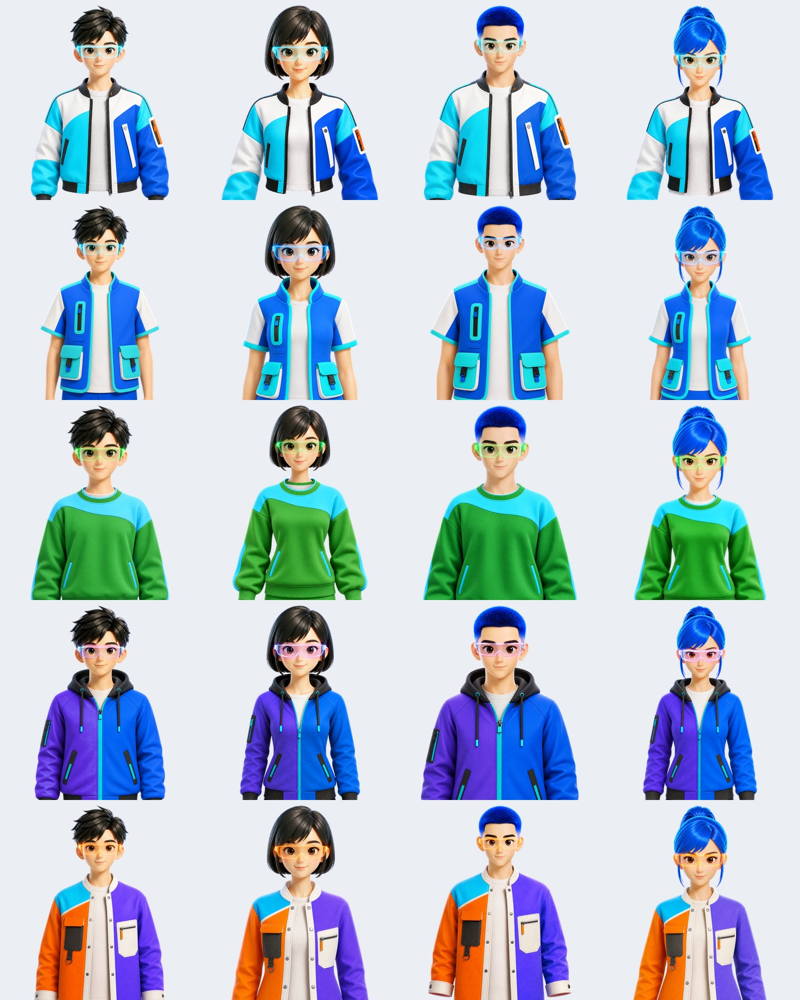

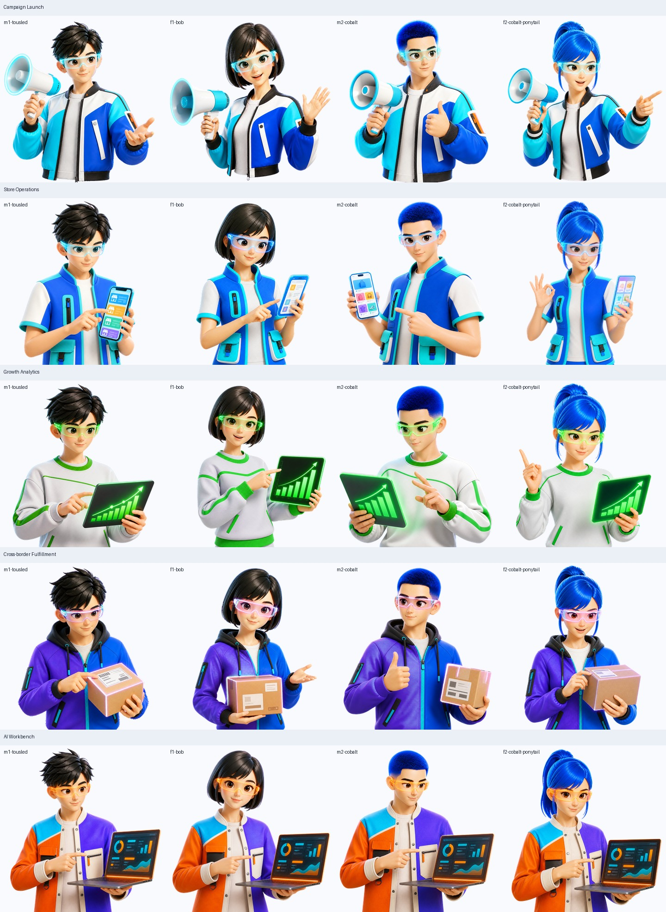

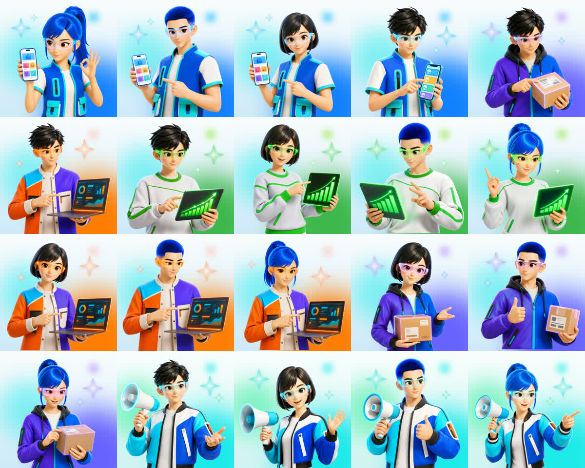

### Cool/cute neo-street collectible

A later quality-validation case explored a more graphic, less human-like, fashion-led collectible direction.

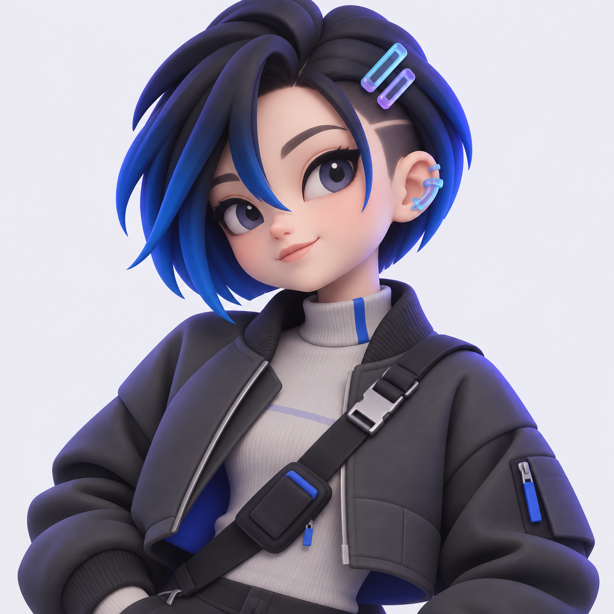

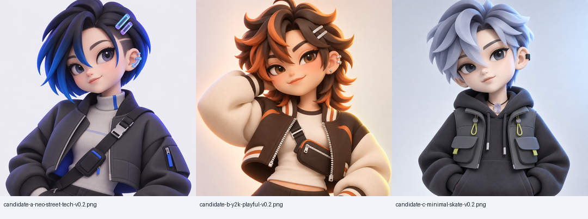

### Review and recovery evidence

The repository also keeps failure/recovery examples so agents do not confuse a technically clean render with a correct identity or approved fashion direction.

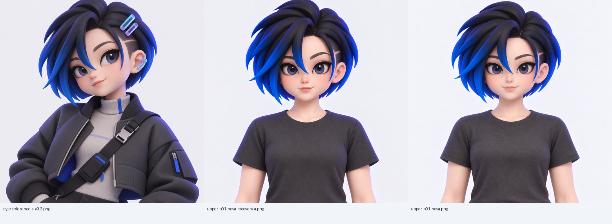

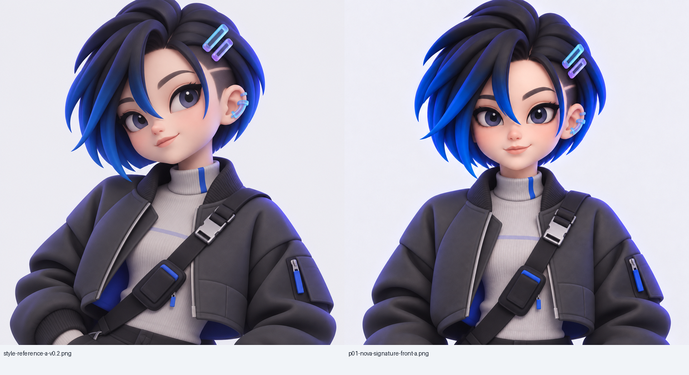

### Reusable workflow and template maps

The English README uses fully English diagrams. Stable template IDs and filenames remain unchanged because agents and scripts call them directly.

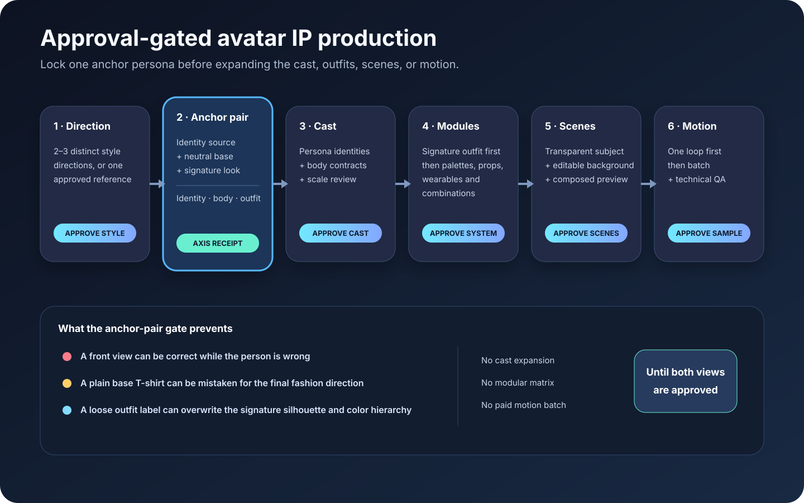

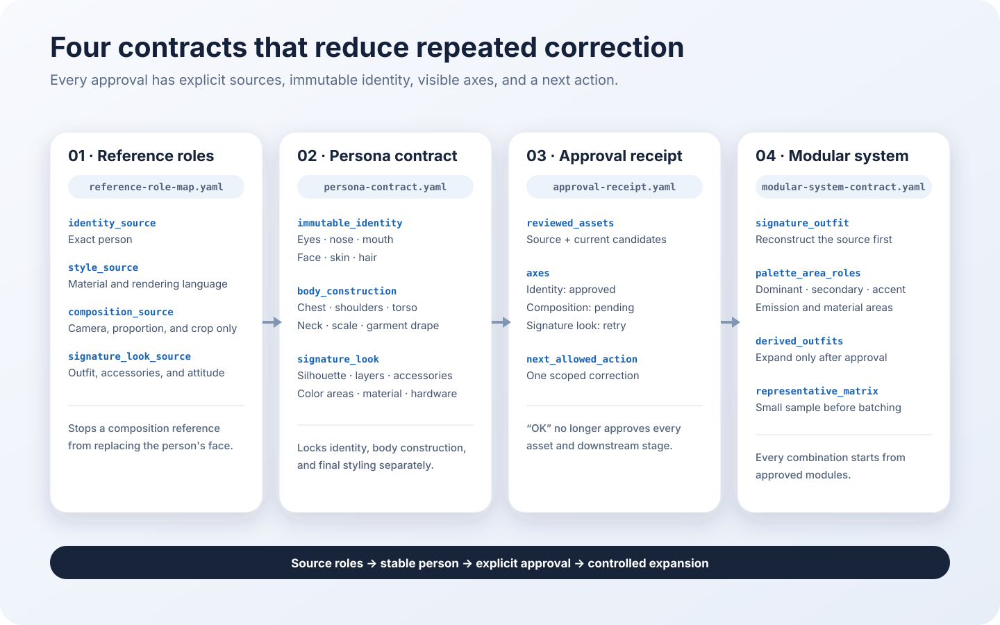

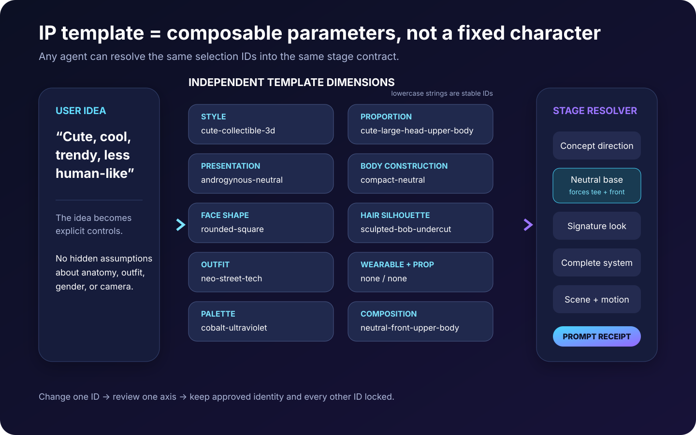

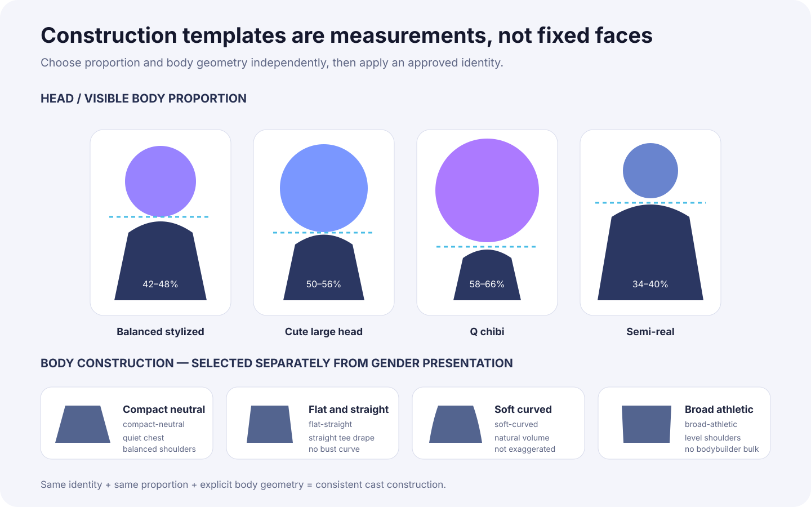

See the annotated [English visual gallery](docs/preview-gallery.md) or [Chinese visual gallery](docs/preview-gallery.zh.md).

## What is packaged

| Layer | Included |
| --- | --- |
| Agent entrypoint | `produce-avatar-ip-system/SKILL.md` |
| Style controls | Cute, chibi/Q, stylized 3D, semi-real, realistic, and custom versioned presets |
| IP parameter templates | Independent proportion, presentation, body, face, hair, outfit, wearable, prop, palette, and composition IDs |
| Prompt system | Identity, wearable, outfit, prop, scene, correction, background, and motion templates |
| Production contracts | Intake brief, prompt contract, asset manifest, approval state machine, and QA gates |
| Reference locks | Reference-role map, persona anatomy contract, neutral/signature anchor pair, and axis-scoped approval receipt |
| Tool routing | Codex/OpenAI host ImageGen, Aident/Fal discovery and execution, Figma organization, Pillow, FFmpeg/ffprobe |
| Helpers | Stage-specific prompt assembly, PNG normalization, contact-sheet generation, and static/video inspection |
| Project scaffold | Resumable folder tree and contracts created by `init_avatar_project.py` |

The repository contains selected generated showcase assets authorized for this public preview. It does not include credentials, signed URLs, private source Figma links, or third-party client source artwork.

## Cross-agent installation

The portable package is [`produce-avatar-ip-system/`](produce-avatar-ip-system/).

```bash
npx skills add Edward-J-create/produce-avatar-ip-system \
  --skill produce-avatar-ip-system
```

Install globally for configured agents:

```bash
npx skills add Edward-J-create/produce-avatar-ip-system \
  --skill produce-avatar-ip-system \
  --global \
  --agent codex claude-code cursor opencode \
  --yes
```

Cross-agent discovery has been smoke-tested with the public `skills` CLI. The same package was discovered and installed for Codex, Claude Code, Cursor, and OpenCode without changing `SKILL.md` or duplicating the workflow. `agents/openai.yaml` is optional OpenAI UI metadata; the portable entrypoint for every host is `produce-avatar-ip-system/SKILL.md`.

Manual installation: copy the complete `produce-avatar-ip-system/` directory to a supported skill directory such as `~/.agents/skills/`, `~/.codex/skills/`, `~/.claude/skills/`, or `.cursor/skills/`.

## Requirements

- An image-generation or image-editing capability for rendered assets.
- Python 3 and Pillow for static helpers.
- FFmpeg/ffprobe for video contact sheets, inspection, transcode, and loop SSIM.
- Optional: an authorized Figma connector for editable component organization.
- Optional: Aident Loadout with an authorized provider connection for explicit external models.

Missing optional capabilities produce a documented partial handoff. The Skill must not claim an unrendered prompt, poster frame, or unmutated Figma file is a finished deliverable.

## Model provenance

The source case used 66 Codex `image_gen` calls for most approved static production. The host exposed `OpenAI Media Service API`, but not a concrete underlying model ID. The repository records those calls as:

```text
Codex image_gen / OpenAI host ImageGen (underlying model ID not exposed)
```

It does not rename them to GPT Image 2 or “Image 2.5.” Explicit external endpoints are recorded by their complete provider IDs. See [`tool-provenance.md`](produce-avatar-ip-system/references/tool-provenance.md).

## Validate

```bash
python3 -m pip install Pillow
python3 scripts/validate_package.py
```

The validator checks package structure, frontmatter, relative links, JSON template IDs, prompt resolution, provenance safeguards, helper syntax/CLIs, preview assets, and accidental private-path or source-Figma leakage.

## License

Invocation-only; see LICENSE.md and the linked licensing history. Provider, product, and model names remain trademarks of their respective owners. Generated-asset rights and provider terms must be evaluated for each production job.
