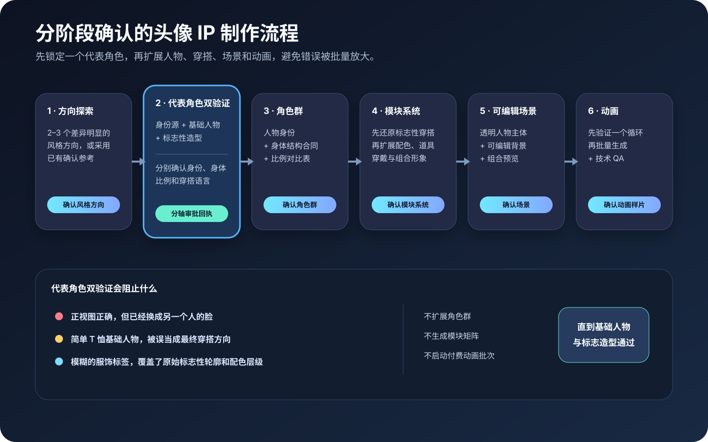
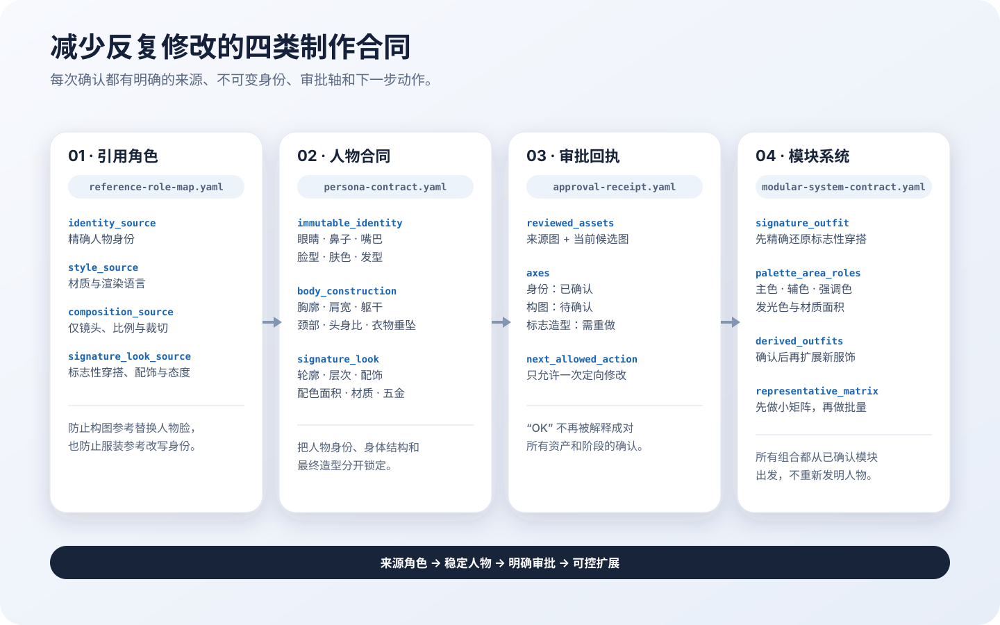
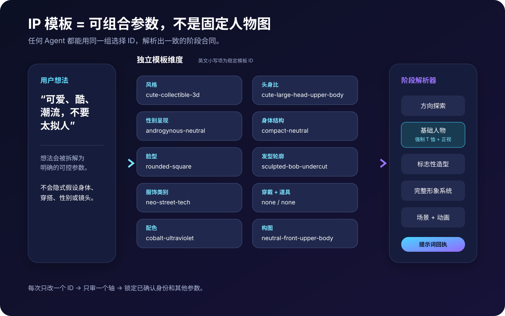
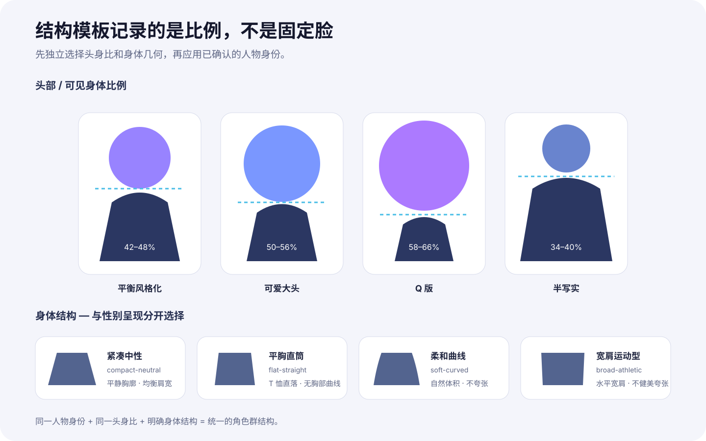

# 可复用头像与数字员工 IP 系统

[English](README.md) | 简体中文

这是一个可跨 Agent 使用的开源 Skill，用于把用户的一句话想法逐步制作成可复用的头像或数字员工 IP 系统，包括人物身份母版、配色、服饰、穿戴、道具、组合形象、可编辑场景和循环动画制作包。

整个流程按阶段确认：

1. 探索基础 IP 方向并确认一种风格。
2. 用同一位代表角色验证中性基础人物与标志性造型。
3. 确认角色群身份与身体结构系统。
4. 先还原标志性穿搭，再扩展配色、服饰、道具、穿戴和组合形象。
5. 产出透明场景主体、可编辑背景和组合预览。
6. 先确认一个代表性动画，再启动视频批量制作。

## 风格与产出范围

这个 Skill 不绑定某一个人物或某一种画风。下面的案例来自两个不同的制作系统，用于展示风格跨度和模块化深度，而不是作为固定人物模板。

### 柔和动漫科技感数字员工

较早的真实制作案例包含四个持续身份、多个服饰系列、不同颜色的光学穿戴、岗位道具、五类出海电商与营销场景，以及可以继续制作循环动画的场景首帧。


### 酷感可爱的新街头收藏玩具风格

后续质量验证案例探索了更概括、更低拟人度、更强调潮流穿搭的收藏玩具方向。


### 审批与纠偏案例

仓库同时保留必要的失败与恢复对照，帮助 Agent 判断“技术上生成成功”是否真的等于身份、比例和穿搭方向正确。


### 可复用工作流与模板图

中文 README 使用完整中文图表。模板 ID、文件名和命令保持英文原文，因为 Agent 与脚本需要直接调用这些稳定标识。









查看带说明的[中文视觉预览页](docs/preview-gallery.zh.md)或[英文视觉预览页](docs/preview-gallery.md)。

## Skill 包含什么

| 层级 | 内容 |
| --- | --- |
| Agent 入口 | `produce-avatar-ip-system/SKILL.md` |
| 风格控制 | 可爱、Q 版、风格化 3D、半写实、写实和自定义版本化预设 |
| IP 参数模板 | 可独立组合的头身比、性别呈现、身体、脸型、发型、服饰、穿戴、道具、配色和构图 ID |
| 提示词系统 | 身份、穿戴、服饰、道具、场景、定向修改、背景和动画模板 |
| 制作合同 | 项目简报、提示词合同、资产清单、审批状态机和质量门 |
| 引用锁 | 引用角色表、人物身体合同、基础人物与标志造型双验证、分轴审批回执 |
| 工具路由 | Codex/OpenAI 宿主生图、Aident/Fal 能力发现与执行、Figma、Pillow、FFmpeg/ffprobe |
| 辅助脚本 | 分阶段提示词组装、PNG 归一化、联系表生成、静态与视频检查 |
| 项目脚手架 | `init_avatar_project.py` 创建的可续接目录和合同 |

仓库只包含经授权用于公开预览的精选生成案例，不包含凭证、签名链接、私有 Figma 源文件地址或第三方客户源素材。

## 跨 Agent 安装

可移植 Skill 包位于 [`produce-avatar-ip-system/`](produce-avatar-ip-system/)。

```bash
npx skills add Edward-J-create/produce-avatar-ip-system \
  --skill produce-avatar-ip-system
```

为机器上已配置的 Agent 全局安装：

```bash
npx skills add Edward-J-create/produce-avatar-ip-system \
  --skill produce-avatar-ip-system \
  --global \
  --agent codex claude-code cursor opencode \
  --yes
```

已使用公开 `skills` CLI 做过跨 Agent 冒烟测试：同一份包可以被 Codex、Claude Code、Cursor 和 OpenCode 发现并安装，不需要修改 `SKILL.md` 或复制多套工作流。`agents/openai.yaml` 只是可选的 OpenAI 界面元数据；所有宿主共用的可移植入口始终是 `produce-avatar-ip-system/SKILL.md`。

手动安装时，将完整的 `produce-avatar-ip-system/` 目录复制到支持的 Skill 目录，例如 `~/.agents/skills/`、`~/.codex/skills/`、`~/.claude/skills/` 或 `.cursor/skills/`。

## 运行要求

- 用于生成或编辑渲染资产的图像能力。
- 用于静态辅助脚本的 Python 3 和 Pillow。
- 用于视频联系表、检查、转码和循环相似度检查的 FFmpeg/ffprobe。
- 可选：已授权的 Figma 连接器，用于可编辑组件整理。
- 可选：已授权外部模型服务商的 Aident Loadout。

缺少可选能力时，Skill 必须交付明确标注的阶段性结果，不得把未渲染提示词、海报帧或未更新的 Figma 文件描述成完整成品。

## 模型来源记录

源制作案例中的大多数已确认静态资产使用了 66 次 Codex `image_gen` 调用。宿主返回了 `OpenAI Media Service API`，但没有暴露具体底层模型 ID，因此仓库记录为：

```text
Codex image_gen / OpenAI host ImageGen (underlying model ID not exposed)
```

仓库不会把它擅自改写为 GPT Image 2 或“Image 2.5”。能够确认的外部模型则记录完整服务商端点。详见 [`tool-provenance.md`](produce-avatar-ip-system/references/tool-provenance.md)。

## 校验

```bash
python3 -m pip install Pillow
python3 scripts/validate_package.py
```

校验器会检查包结构、入口元数据、相对链接、JSON 模板 ID、提示词解析、模型来源保护、辅助脚本、预览资产，以及是否意外包含本机路径或源 Figma 地址。

## 许可证

MIT。服务商、产品和模型名称仍属于各自权利方。每次实际制作都需要分别确认生成资产权利和服务商条款。
